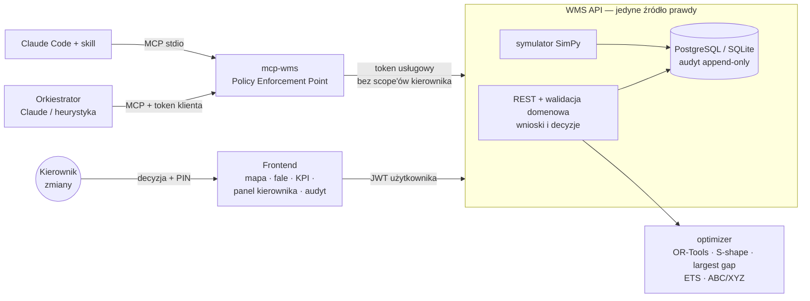
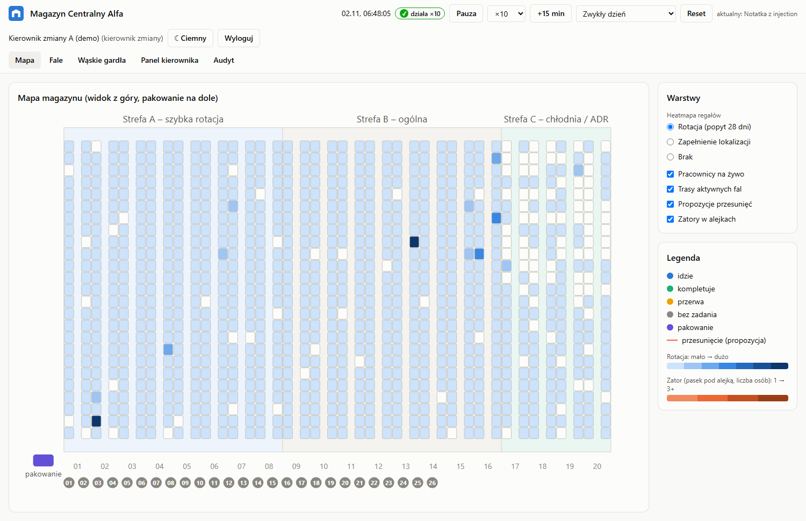
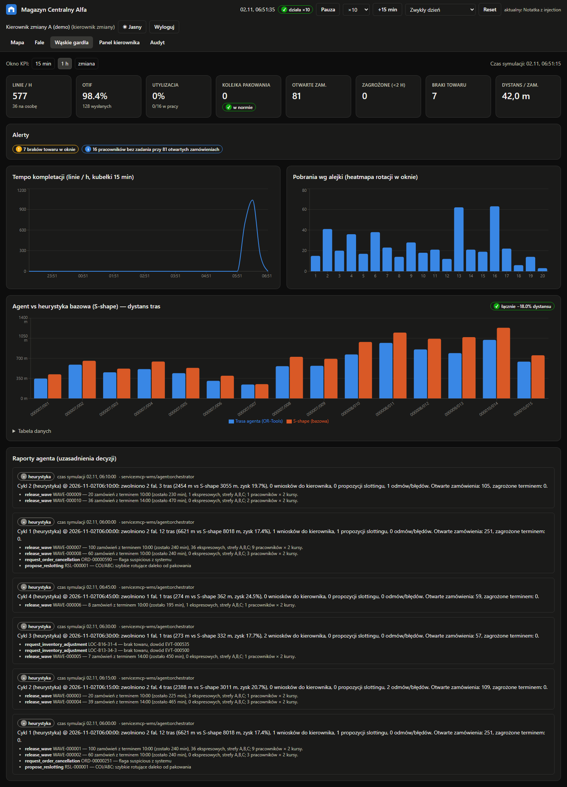
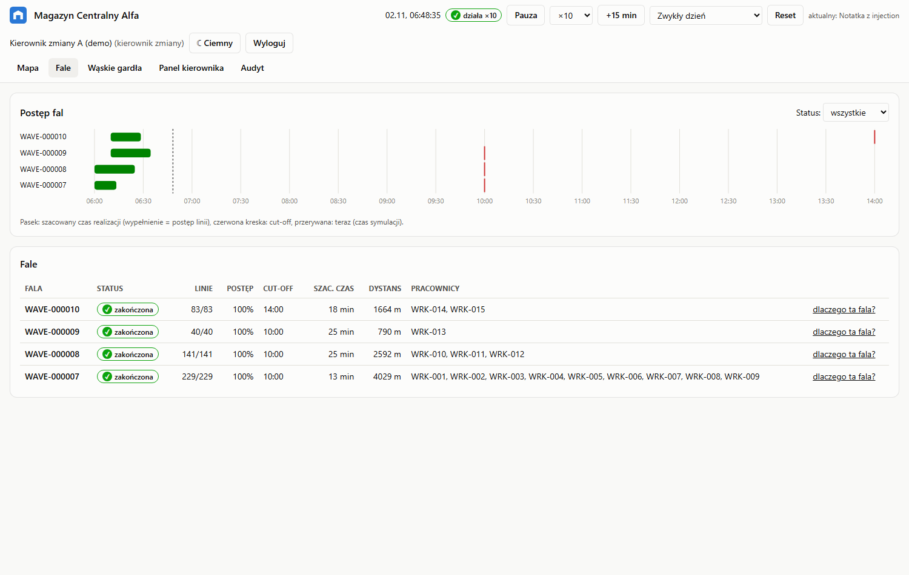

# Optymalizacja kompletacji zamówień — „Magazyn Centralny Alfa”

[](https://github.com/KFukas/OptymalizacjaZamowienMag/actions/workflows/ci.yml)

Symulacja magazynu e-commerce (dane **wyłącznie syntetyczne**) z agentem AI, który planuje fale kompletacji,
trasy zbierania i przesunięcia towaru, korzystając z solvera tras (OR-Tools) i prognozy popytu. Agent rozmawia
z systemem magazynowym **wyłącznie** przez własny serwer MCP `mcp-wms`, w którym **granica uprawnień jest
egzekwowana po stronie serwera**: wąsko typowane narzędzia, deny-by-default, walidacja schematu i domeny, limity,
audyt z łańcuchem hashy. Operacji nieodwracalnych (anulowanie zamówienia, korekta stanu) agent nie może wykonać —
może jedynie złożyć wniosek, o którym decyduje kierownik zmiany z ponownym potwierdzeniem PIN-em.

Bezpieczeństwo nie zależy od tego, czy model „posłucha”: 97 testów udaje złośliwego agenta (ukryte narzędzia,
pola `approved: true`, zmienione opisy narzędzi, replay, wyścigi, prompt injection w danych), a ewaluacja
„złośliwego agenta” kończy się **0 nieautoryzowanych zmian stanu**.



| Mapa magazynu (heatmapa rotacji, trasy, pracownicy) | Wąskie gardła i agent vs S-shape |
|---|---|
|  |  |
| **Panel kierownika (wniosek z injection, flagi)** | **Postęp fal (Gantt, cut-off)** |
|  |  |

## Szybki start

```bash
git clone https://github.com/KFukas/OptymalizacjaZamowienMag.git && cd OptymalizacjaZamowienMag
python scripts/gen_secrets.py --init
docker compose up --build -d                       # UI: http://localhost:5173 · API: http://localhost:8000/docs
docker compose --profile agent up -d orchestrator  # agent planujący (bez LLM; AGENT_MODE=llm dla Claude)
```

Bez Dockera (Python 3.12 + Node 20): na Windows **dwuklik w `Uruchom.bat`** (Linux/macOS: `./uruchom.sh`) —
przygotowuje środowisko i startuje WMS, frontend, symulację i agenta naraz. Szczegóły, konta demo
i podłączenie do Claude Code: **[docs/INSTRUKCJA_URUCHOMIENIA.md](docs/INSTRUKCJA_URUCHOMIENIA.md)**.

## Najważniejsze wyniki

| Obszar | Wynik |
|---|---|
| Trasy (benchmark, układ medium, 20 instancji) | OR-Tools vs S-shape: **−26,5%** (10 zam.), **−20,5%** (20 zam.), **−9,2%** (40 zam.); lepsze w 60/60 instancji |
| Trasy w symulacji (agent, 20 tras) | **−18,5%** dystansu względem S-shape dla tych samych kursów |
| Prognoza (ETS vs naiwny sezonowy, top 50 SKU) | WAPE **0,090** vs 0,125 |
| Granica uprawnień | **97/97** testów `tests/security/`; ewaluacja injection offline: 37/37 prób zabronionych odrzuconych, 9/9 wniosków oflagowanych, **0** nieautoryzowanych zmian |
| Testy | ~185 testów Python (pytest + hypothesis) + Vitest; CI: lint, typy, backend, security, solver, frontend, docker compose |

## Dokumentacja

| Dokument | Zawartość |
|---|---|
| [INSTRUKCJA_URUCHOMIENIA](docs/INSTRUKCJA_URUCHOMIENIA.md) | wymagania, `.env`, PowerShell / bash / Docker, MCP w Claude Code i Desktop, konta demo, problemy |
| [ARCHITEKTURA](docs/ARCHITEKTURA.md) | komponenty, strefy zaufania, przepływy (Mermaid) |
| [BEZPIECZENSTWO](docs/BEZPIECZENSTWO.md) | model zagrożeń, warstwy obrony, `policy.yaml`, ryzyka szczątkowe |
| [MCP](docs/MCP.md) | każde narzędzie: schemat, scope, walidacja, błędy, przykłady |
| [ZATWIERDZENIA](docs/ZATWIERDZENIA.md) | cykl życia wniosku, TTL, separation of duties, optimistic locking |
| [OPTYMALIZACJA](docs/OPTYMALIZACJA.md) | algorytmy, benchmarki, prognoza i jej błąd, slotting |
| [SYMULACJA](docs/SYMULACJA.md) | dane syntetyczne, parametry, scenariusze, silnik SimPy |
| [SKILL](docs/SKILL.md) | skill Claude Code — kiedy się włącza, jak rozszerzać |
| [API](docs/API.md) | endpointy REST, role i scope'y (plus OpenAPI `/docs`) |
| [PANEL_KIEROWNIKA](docs/PANEL_KIEROWNIKA.md) | instrukcja dla kierownika zmiany |
| [TESTY_BEZPIECZENSTWA](docs/TESTY_BEZPIECZENSTWA.md) | katalog przypadków, jak dodać nowy, evale |
| [DECYZJE](docs/DECYZJE.md) | rejestr decyzji projektowych (ADR-lite) |
| [RAPORT_WYKONANIA](docs/RAPORT_WYKONANIA.md) | co zrobiono, jak działa end-to-end, wyniki, ograniczenia |
| [CHANGELOG](CHANGELOG.md) | historia zmian per kamień milowy |

## Licencja

MIT — zob. [LICENSE](LICENSE). Projekt demonstracyjny; nazwy, osoby i dane są fikcyjne.
