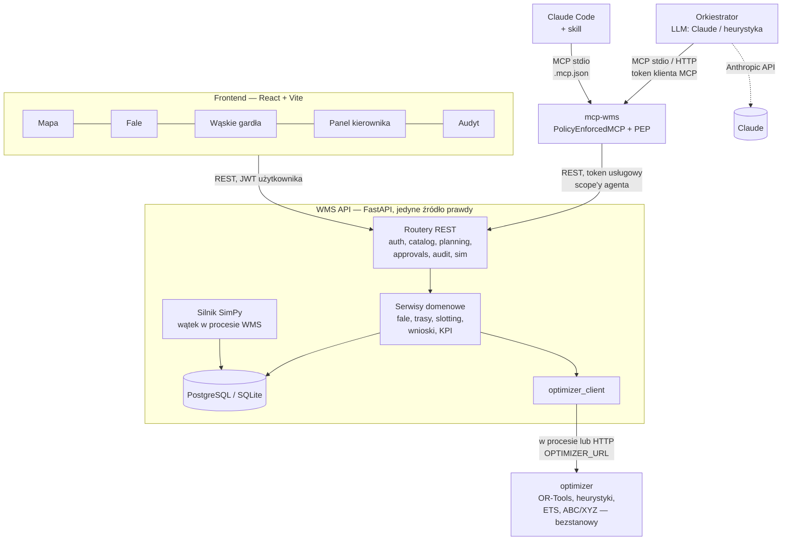
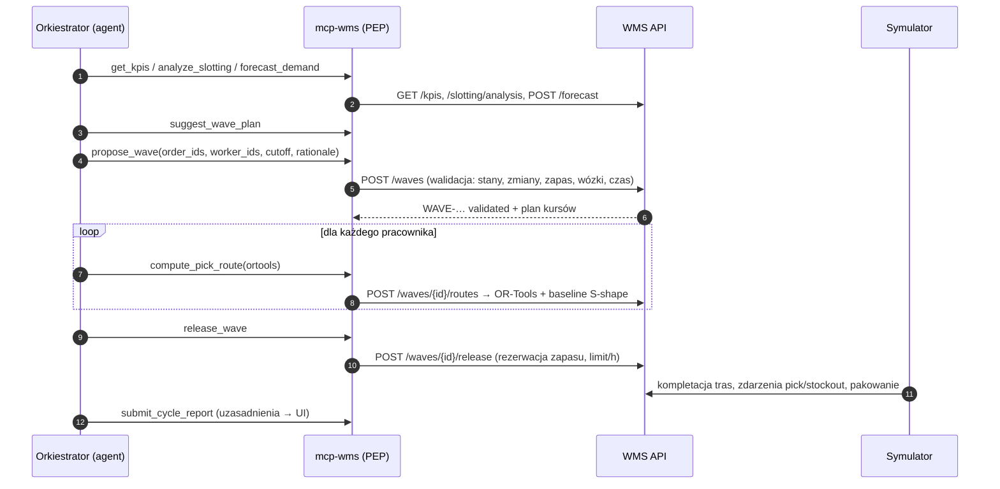
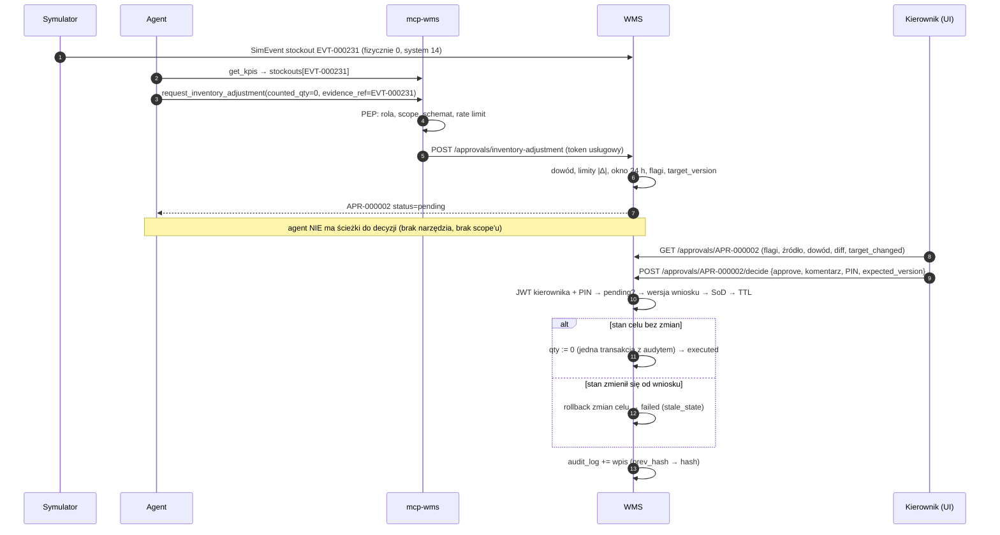

# Architektura

## Komponenty

| Komponent | Kod | Odpowiedzialność | Nie robi |
|---|---|---|---|
| WMS API | `wms/` | stan magazynu, walidacja domenowa, auth, wnioski i decyzje, audyt, KPI, sterowanie symulacją | nie ufa żadnemu klientowi |
| Silnik symulacji | `simulator/engine.py` | napływ zamówień, realizacja zwolnionych fal, braki, pakowanie, pozycje | nie podejmuje decyzji planistycznych |
| Generator danych | `simulator/generate.py` | świat syntetyczny z ziarnem, scenariusze | — |
| Optymalizator | `optimizer/` | graf, trasy, batching, sugestie fal, prognoza, slotting, benchmark | brak dostępu do bazy i zapisu |
| mcp-wms | `mcp_wms/` | 19 wąskich narzędzi, PEP, audyt wywołań | brak dostępu do bazy (test AST), brak sekretu JWT |
| Orkiestrator | `orchestrator/` | pętla agenta co N min symulacji, limity, dziennik wywołań | brak innych narzędzi niż MCP |
| Frontend | `frontend/` | wizualizacja, panel kierownika | brak logiki uprawnień (egzekwuje WMS) |

## Strefy zaufania

| Strefa | Elementy | Zaufanie |
|---|---|---|
| Niezaufana | teksty z danych, wynik modelu, argumenty narzędzi | zero — wszystko walidowane |
| Pośrednia | orkiestrator, mcp-wms | ograniczone scope'y; zakładamy możliwość przejęcia |
| Zaufana | WMS + baza | egzekwuje niezmienniki; decyzje nieodwracalne tylko z tokenem kierownika |
| Człowiek | kierownik zmiany | ostatnia linia dla operacji nieodwracalnych |

## Przepływ: cykl planowania

## Przepływ: wniosek agenta → decyzja kierownika → wykonanie

## Dane i czas

- Baza: SQLite (dev/testy, `init_db`) lub PostgreSQL (docker, `alembic upgrade head`). Migracje: `wms/migrations`.
- Dwa zegary (D-005): czas symulacji dla domeny, zegar ścienny dla bezpieczeństwa (TTL, limity, audyt).
- Zapis serializowany blokadą procesu (`wms/deps.py`) + `FOR UPDATE` nagłówka audytu (PostgreSQL).
- Reset świata zachowuje audyt, wnioski i liczniki ID (D-010).

## Wdrożenie (docker compose)

| Usługa | Obraz | Port | Uwagi |
|---|---|---|---|
| `db` | postgres:16-alpine | — | wolumen `pgdata` |
| `optimizer` | `magazyn-alfa/python` | — | `uvicorn optimizer.service:app` |
| `wms-api` | `magazyn-alfa/python` | 8000 | migracje + dane demo przy pierwszym starcie, symulator w procesie |
| `mcp-wms` | `magazyn-alfa/python` | 8765 | streamable HTTP, `Authorization: Bearer` |
| `frontend` | nginx | 5173 | statyczny build Vite |
| `simulator` | `magazyn-alfa/python` | — | profil `tools`: regeneracja danych scenariusza |
| `orchestrator` | `magazyn-alfa/python` | — | profil `agent`: pętla agenta przez mcp-wms (HTTP) |

Decyzje projektowe: [DECYZJE.md](DECYZJE.md). Bezpieczeństwo: [BEZPIECZENSTWO.md](BEZPIECZENSTWO.md).
