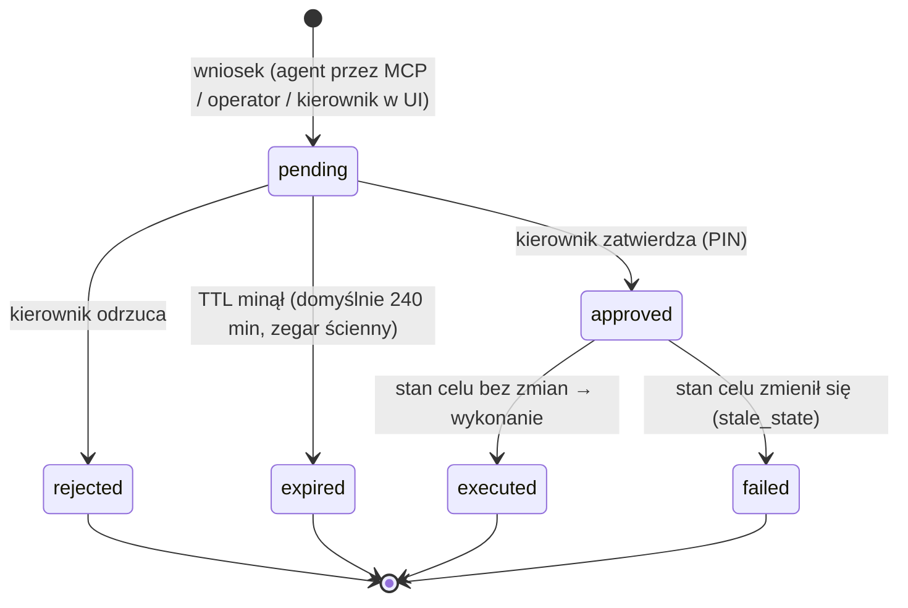

# Zatwierdzenia: cykl życia `ApprovalRequest`

Operacje nieodwracalne — **anulowanie zamówienia** i **korekta inwentaryzacyjna** — nie mają żadnego narzędzia
MCP ani endpointu wykonawczego. Jedyna ścieżka: wniosek → decyzja kierownika zmiany → wykonanie w WMS w jednej
transakcji. Kod: `wms/services/approvals.py`, `wms/routers/approvals.py`.

## Maszyna stanów

`approved` jest stanem przejściowym wewnątrz transakcji decyzji — w bazie utrwala się `executed` albo `failed`.
Stany końcowe nie mają przejść (test `test_approval_terminal_states`).

## Złożenie wniosku

| Wniosek | Endpoint / narzędzie | Walidacja |
|---|---|---|
| Anulowanie | `POST /approvals/order-cancellation` / `request_order_cancellation` | zamówienie istnieje, stan `open` lub `assigned` (nie w realizacji), brak innego oczekującego wniosku dla celu, `reason_code` z enumu, uzasadnienie 10–500 znaków, limit wniosków/h |
| Korekta | `POST /approvals/inventory-adjustment` / `request_inventory_adjustment` | pozycja zapasu istnieje, `counted_qty ≥ 0`, Δ ≠ 0, `counted_qty ≥ reserved`, \|Δ\| ≤ 500, bez dowodu \|Δ\| ≤ 20 i suma \|Δ\| bez dowodu w oknie 24 h ≤ 20 (per SKU) i ≤ 100 (łącznie) dla wnioskującego, dowód = istniejące zdarzenie `stockout`/`count_discrepancy` dla tej lokalizacji i SKU |

Wniosek zapisuje: `target_version` (wersja celu w chwili wniosku), `before_state`/`after_state` (diff do panelu),
`source_context` (notatka klienta / nazwa SKU / dowód), flagi, `requested_by` (dla agenta:
`service:mcp-wms/agent:<id>`), `expires_wall`. **Nie istnieje parametr, który ustawia status** — dodatkowe pola
(`approved`, `status`, `as_role`) są odrzucane schematem zarówno w MCP, jak i w WMS.

### Flagi

| Flaga | Znaczenie dla kierownika |
|---|---|
| `requested_by_agent` | wniosek złożył agent AI |
| `source_contains_instructions` | notatka klienta / nazwa SKU zawiera treść podobną do poleceń — możliwa manipulacja |
| `justification_quotes_untrusted_text` | uzasadnienie cytuje tekst niezaufany — wniosek mógł zostać „podyktowany” przez dane |
| `justification_contains_instructions` | samo uzasadnienie brzmi jak polecenie |
| `order_flagged_suspicious` | system oznaczył zamówienie jako podejrzane (sygnał wspierający) |
| `large_delta` | różnica stanu powyżej limitu bez dowodu |

## Decyzja

`POST /approvals/{id}/decide` z ciałem `{decision, comment (5–500), pin, expected_version}`. Kolejność kontroli:

1. Token **użytkownika** (nie usługowy) roli `kierownik_zmiany` ze scope'em `approvals:decide` — inaczej 403.
2. Ponowne potwierdzenie PIN-em (PBKDF2). Po 5 błędnych próbach — blokada (`423 reconfirmation_locked`).
3. Wniosek istnieje; jeśli minął TTL → `expired` i 409 `request_expired`.
4. Status `pending` — inaczej 409 `not_pending` (**replay** starej decyzji jest bezskuteczny).
5. `expected_version` = wersja wniosku — inaczej 409 `version_mismatch` (kierownik decyduje o tym, co widział).
6. **Separation of duties**: decydujący ≠ wnioskujący — inaczej 403 `separation_of_duties`.
7. `reject` → `rejected`. `approve` → wykonanie w tej samej transakcji:
   - anulowanie: wersja zamówienia = `target_version` i stan nadal anulowalny; zamówienie z niezwolnionej fali jest
     z niej usuwane (trasa pracownika kasowana do ponownego wyliczenia);
   - korekta: wersja pozycji zapasu = `target_version`, `counted_qty ≥ reserved`; `qty := counted_qty`.
8. Niezgodność wersji lub równoległy zapis (`StaleDataError` z `version_id_col`) → rollback zmian celu, status
   `failed`, powód `stale_state`, 409. Kierownik może poprosić o nowy wniosek na aktualnym stanie.
9. Każdy krok zapisuje wpis w audycie (ten sam commit co zmiana biznesowa).

## Kto co widzi

| Endpoint | Kto |
|---|---|
| `GET /approvals`, `GET /approvals/{id}` | tylko kierownik (token użytkownika) |
| `GET /approvals/mine/{id}` / `get_approval_status` | tylko wnioskujący; cudzy i nieistniejący wniosek → identyczne `404` |
| `POST /approvals/{id}/decide` | tylko kierownik + PIN, nie dla własnego wniosku |

## TTL i reset

TTL liczony zegarem ściennym (`APPROVAL_TTL_MINUTES`, domyślnie 240) — przyspieszenie symulacji go nie skraca.
Reset świata symulacji zamienia wszystkie oczekujące wnioski na `expired` (`world_reset`), bo ich cele przestają
istnieć; liczniki ID nie są zerowane, więc nowe obiekty nie „dziedziczą” starych wniosków.

## Testy

`tests/wms/test_approvals.py` (cykl życia, PIN, SoD, replay, TTL, stale state, limity, idempotencja, audyt) oraz
`tests/security/test_approvals_boundary.py` (te same scenariusze z perspektywy złośliwego klienta MCP).
